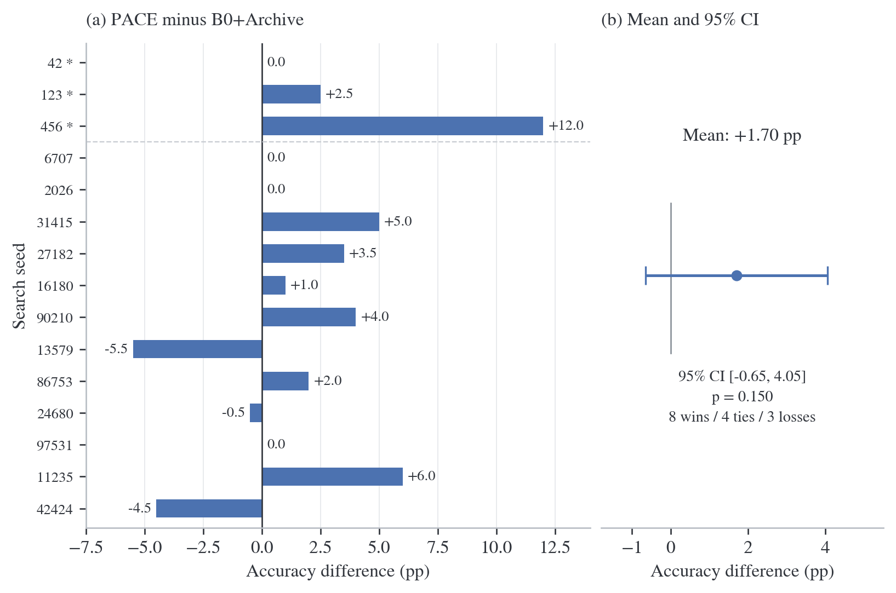

# PACE

**Paired-Assessment with Confidence-Preserving Evolution**

Guosheng Wang · DSAI6707 Advanced Computational Intelligence

PACE studies survivor selection in evolutionary prompt optimization. It uses
paired observations to decide when a prompt can be removed, and a bounded archive
to keep unresolved candidates. The experiments use AG News and Qwen2.5-7B-Instruct.

[Read the paper](paper/main.pdf) · [LaTeX source](paper/main.tex) ·
[Paper build instructions](paper/README.md) ·
[Primary results](outputs/pace/gate2_cap_align_15seed/PACE_GATE2_15SEED.md)

## Results

The primary online comparison matches the active population, archive capacity,
search budget and evaluation policy across 15 paired search seeds.

| Measure | B0+Archive | PACE |
| --- | ---: | ---: |
| Held-out accuracy | 78.4% | 80.1% |
| Deployment tokens per example | 112.6 | 115.5 |
| Mean acquired search observations | 1,275 | 1,276 |
| Retention capacity | 16 | 16 |

The mean paired accuracy difference is **+1.70 percentage points**, with a
95% Student-t interval of **[−0.65, 4.05] points** and a two-sided sign-flip
permutation p-value of **0.150**. The interval includes zero. The first three
seeds were exploratory; the remaining twelve extend that study. All runs use
the same 200 held-out examples.



Offline replay reduced false elimination from 18.3% to 2.5% at budget 640.
That comparison uses different retention capacities (8 for B0, 16 for PACE),
so it measures the combined gate-and-archive effect. The bootstrap gate is a
selection heuristic; it has no simultaneous or anytime-valid coverage guarantee.

## Repository contents

| Path | Contents |
| --- | --- |
| `paper/` | Current manuscript, compiled PDF, seven figures and plotting script |
| `src/pace/` | Paired bootstrap, survivor rule and audit metrics |
| `src/policies/` | Evaluation-allocation policies, including Paired Racing |
| `configs/pace_gate2_cap_align_15seed.yaml` | Frozen primary online configuration |
| `data/` | Prompt pool and fixed search/test manifest |
| `outputs/pace/gate1/` | Offline PACE replay records |
| `outputs/pace/gate2_cap_align_15seed/` | 30 primary run records and paired summaries |
| `outputs/pace/gate2_cap_align_15seed/analysis/` | Descriptive archive audit |
| `tests/` | Budget, pairing, metrics and information-access checks |
| `reports/` | Earlier course report and presentation outline |

The current paper reviews 20 core studies in five categories. Each section has
at most five subsections. Earlier DICE experiments are retained under
`outputs/gate1/`, `outputs/gate2/` and `reports/DICE_PO_Technical_Report.md`;
they are not included in the PACE primary estimate.

## Setup and CPU checks

Use Python 3.11 or a compatible environment. From a fresh checkout:

```bash
git clone https://github.com/moonriver0922/DSAI6707-PACE.git
cd DSAI6707-PACE
python3 -m venv .venv
source .venv/bin/activate
python -m pip install -r requirements.txt
```

The following commands use the stored records and do not load the language model:

```bash
python -m pytest
python paper/make_figures.py
PYTHONPATH=src python scripts/run_pace_gate1.py \
  --config configs/pace_gate1.yaml \
  --out-dir outputs/reproduced/pace_gate1
```

The plotting script validates online values against the 30 raw JSON records and
writes vector PDFs plus PNG previews to `paper/figures/`. To recompute the primary
summary without overwriting the archived results:

```bash
mkdir -p outputs/reproduced/primary
cp outputs/pace/gate2_cap_align_15seed/{pace,b0_archive}_s*.json \
  outputs/reproduced/primary/
PYTHONPATH=src python scripts/aggregate_pace_gate2_15seed.py \
  --config configs/pace_gate2_cap_align_15seed.yaml \
  --out-dir outputs/reproduced/primary
```

## Build the paper

The paper uses the official NeurIPS 2026 style in preprint mode. Compile with
Tectonic or a LaTeX installation that includes `latexmk`:

```bash
cd paper
tectonic main.tex
# Alternative: latexmk -pdf main.tex
```

For Overleaf, upload `main.tex`, `neurips_2026.sty`, `sections/` and `figures/`,
then select `main.tex` as the main document. References are embedded in the TeX;
a separate BibTeX step is unnecessary. See [paper/README.md](paper/README.md)
for the figure list and source-verification notes.

## Run new model evaluations

The original runs used one NVIDIA A100 80GB, BF16 and greedy decoding with at
most eight new tokens. The CPU requirements file does not install the GPU stack.
Install CUDA-compatible PyTorch, Transformers, Accelerate, Datasets, Tokenizers
and SentencePiece in the inference environment, with access to
`Qwen/Qwen2.5-7B-Instruct`.

Use a separate output directory for new runs:

```bash
PYTHONPATH=src python scripts/run_pace_gate2.py \
  --config configs/pace_gate2_cap_align_15seed.yaml \
  --out-dir outputs/reproduced/online \
  --experiment reproduced_primary \
  --device cuda:0
```

This is the entry point for rerunning the protocol, not a claim that a new GPU
run has been performed. Existing JSON records remain the evidence for the paper.

## Accounting and limitations

- The 1,280-observation budget counts newly acquired prompt–sample pairs within
  each search state. An inference-cache hit can still count as a new observation
  for that run; the counter is not a physical GPU-call total.
- The evaluator retains historical prompt IDs after survivor removal. The paper
  documents this behavior; changing it would require new experiments.
- Parent IDs are incomplete in the saved logs. Archive-to-active transitions
  indicate breeding opportunities, not verified descendant contributions.
- One dataset, one target model and a shared 200-example test set limit how far
  the observed effect can be generalized.

The stored results and configurations are kept unchanged. Generated replay
outputs, environments, model weights and caches are excluded from version control.
