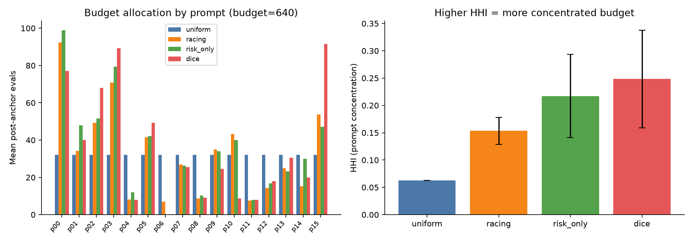

# Gate 1 Mechanism Diagnosis (budget=640, 0 new LLM calls)

## Diagnosis table (mean over 20 seeds)

| policy    |   calls_used_mean |   budget_util_mean |   column_share_mean |   pair_share_mean |   hhi_mean |   hhi_std |   top3_share_mean |   n_pair_batches_mean |   n_unique_pairs_mean |   repeat_pair_share_mean |   regret_mean |   regret_std |
|:----------|------------------:|-------------------:|--------------------:|------------------:|-----------:|----------:|------------------:|----------------------:|----------------------:|-------------------------:|--------------:|-------------:|
| dice      |             539.7 |             0.8433 |              0.0008 |            0.9992 |     0.2483 |    0.0895 |            0.7747 |                 15.35 |                 10.1  |                   0.5215 |        0.0141 |       0.0155 |
| racing    |             637   |             0.9953 |              0.1454 |            0.8546 |     0.1535 |    0.0246 |            0.5925 |                 17.8  |                 11.25 |                   0.5631 |        0.0058 |       0.0054 |
| risk_only |             555.8 |             0.8684 |              0      |            1      |     0.2172 |    0.0764 |            0.7014 |                 17.75 |                 11.2  |                   0.5624 |        0.0138 |       0.0194 |
| uniform   |             640   |             1      |              1      |            0      |     0.0625 |    0      |            0.1875 |                  0    |                  0    |                   0      |        0.0059 |       0.0031 |

## Key contrasts

- **Budget utilization**: Racing 0.995 vs DICE 0.843 (DICE often stops early when pair queries idle).
- **Column-fill share** (Uniform-style / Racing fallback): Racing 0.145 vs DICE 0.001.
- **Prompt HHI**: Racing 0.153 vs DICE 0.248; top-3 share Racing 0.593 vs DICE 0.775.
- **Unique pairs**: Racing 11.2 vs DICE 10.1.
- **Jaccard(DICE, Risk-Only) pairs** mean = 0.220 (impact *does* change which pairs are bought).
- **Jaccard(DICE, Racing) pairs** mean = 0.212.

## Winner@λ=0.5 distribution

| policy    | winner_0.5   |   n |   share |
|:----------|:-------------|----:|--------:|
| dice      | p00          |   3 |    0.15 |
| dice      | p02          |   1 |    0.05 |
| dice      | p03          |   3 |    0.15 |
| dice      | p04          |   1 |    0.05 |
| dice      | p14          |   1 |    0.05 |
| dice      | p15          |  11 |    0.55 |
| racing    | p00          |   8 |    0.4  |
| racing    | p02          |   1 |    0.05 |
| racing    | p03          |   4 |    0.2  |
| racing    | p05          |   3 |    0.15 |
| racing    | p15          |   4 |    0.2  |
| risk_only | p00          |   4 |    0.2  |
| risk_only | p03          |   5 |    0.25 |
| risk_only | p05          |   4 |    0.2  |
| risk_only | p10          |   1 |    0.05 |
| risk_only | p11          |   2 |    0.1  |
| risk_only | p15          |   4 |    0.2  |
| uniform   | p00          |   2 |    0.1  |
| uniform   | p03          |   8 |    0.4  |
| uniform   | p05          |   1 |    0.05 |
| uniform   | p15          |   9 |    0.45 |

## Mechanism reading

1. **Code confound**: `PairedRacingPolicy` uses `stop_r` and falls back to `uniform_column_queries`; `DICEPolicy` / `RiskOnlyPolicy` use `stop_r=None` and never fall back. Registered comparison therefore mixes pair-scoring with stop/explore policy.
2. **Concentration**: DICE puts a larger fraction of post-anchor budget on few prompts (esp. paths that lock `p15` as λ=0.5 winner in 55% of seeds).
3. **Impact without VOI**: Decision impact changes pair sets vs Risk-Only (Jaccard≈0.22) but does not reduce regret — consistent with “high risk/impact ≠ expected regret reduction”.
4. Do **not** retune DICE to chase wins; optional future work is VOI / expected regret reduction, or a controlled ablation that equalizes early-stop + uniform fallback across policies.
