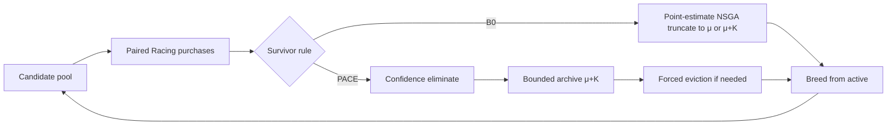

# PACE: Improving Evolutionary Prompt Optimization with Confidence-Aware Selection

**Course:** DSAI6707 Advanced Computational Intelligence  
**Type:** Course project report (Evolutionary Computation + Emerging AI)  
**Hardware:** NVIDIA A100-SXM4-80GB  
**Model / Task:** Qwen2.5-7B-Instruct · AG News classification  
**Status:** Results frozen; no further algorithm or GPU experiments for delivery  

---

## Abstract

Automatic prompt optimization with evolutionary algorithms is attractive for multi-objective goals (task accuracy vs. inference cost), but under a **fixed evaluation budget** point-estimate ranking is noisy: promising prompts can be discarded too early. We propose **PACE** (*Paired-Assessment with Confidence-Preserving Evolution*): an **evidence-gated survivor selection** rule that eliminates a candidate only when paired bootstrap evidence supports a cheaper-or-equal rival with a strictly better accuracy lower bound, otherwise retaining it in a bounded archive.  

On a frozen offline matrix, false elimination of reference Pareto prompts falls from **18.3%** (point-estimate NSGA truncate) to **2.5%** (PACE). In a capacity-matched online comparison (15 seeds, 1,280 search calls each), mean sealed-test accuracy rises from **78.4%** to **80.1%** (paired Δ = +1.7 pp; 95% CI [−0.65, +4.05] pp; Win/Tie/Loss = 8/4/3). The online gain is a **positive trend**, not a statistically confirmed stable advantage. We conclude that confidence-aware survival reduces premature elimination and can improve final prompts, with remaining variance and capacity pressure as clear limitations.

---

## 1. Introduction

Large language models are highly sensitive to prompt wording. Evolutionary and multi-objective prompt optimizers (e.g., cost-aware and Pareto-style search) explore candidate instructions under a hard limit on how many \((p,x)\) evaluations can be purchased during search [1–5]. With few shared samples, empirical accuracy and cost are noisy: a standard NSGA-II truncate-on-estimates step may **eliminate a prompt that would have remained non-dominated** given more data.

**Research question.** Under a fixed search-call budget, can a **confidence-aware survivor rule**—using paired comparisons on shared samples—reduce erroneous early eliminations, and does that translate into better sealed-test prompts?

**Contribution (course scope).** We implement PACE on top of a matched Paired-Racing evaluation loop and NSGA-II variation, compare it to capacity-aligned baselines, and report offline elimination metrics plus a 15-seed online accuracy study. We do **not** claim SOTA over the broader prompt-optimization literature; the claim is a clear, falsifiable mechanism study suitable for a course project.

---

## 2. Related Work (≥20 sources, thematic)

### 2.1 Automatic and evolutionary prompt optimization

Discrete prompt search ranges from gradient-free rewrite methods to evolutionary operators that mutate instructions and few-shot exemplars [1,6–10]. Cost-aware evolutionary optimizers such as **CAPO** integrate racing and length/cost penalties to reduce evaluation waste [1]. Multi-objective extensions (**MO-CAPO**) explicitly trade task performance against deployment-oriented token cost and report Pareto sets rather than a single scalarized prompt [2]. Related lines study instruction induction, APO variants, and LLM-as-operator mutation [6–10].

### 2.2 Budgeted evaluation, racing, and noisy ranking

When each evaluation is expensive, **racing** and early stopping discard clearly inferior candidates on shared samples [1,11–13]. Classical racing and bandit-style allocation reduce mean evaluations; recent fixed-budget noisy evolution work emphasizes the trade-off between **ranking fidelity** and **search depth**—spending budget to stabilize today’s ranking can starve later generations [14]. Dynamic resampling and statistical ranking under noise remain active themes in evolutionary computation [15–17].

### 2.3 Multi-objective evolutionary algorithms

NSGA-II-style non-dominated sorting and crowding remain the default scaffold for bi-objective accuracy–cost search [18,19]. In prompt optimization, the same machinery is often applied to **point estimates** of accuracy and cost; our baseline inherits that practice and changes only the survival rule.

### 2.4 Confidence, pairwise tests, and safe elimination

Paired differences on common instances reduce variance versus independent samples [11,20]. Bootstrap and nonparametric intervals are standard tools for noisy comparisons when parametric assumptions are weak [21]. Anytime-valid / sequential testing is a stronger alternative we do **not** claim; PACE uses a simple precommitted bootstrap gate for course-scale clarity [22,23].

### 2.5 Positioning

Prior work improves **which evaluations to buy** (racing, CAPO-style intensification) or **which objectives to optimize** (MO-CAPO). PACE focuses on a complementary lever: **when survival decisions are justified** under paired evidence, with a bounded archive so undecided candidates are not discarded solely by a noisy rank cut. Soft probabilistic elite weighting [14,17] is related future work; it is **out of scope** for this delivery.

**References used in themes above (numbered):** [1] Zehle et al., CAPO, AutoML 2025. [2] Büssing et al., MO-CAPO, arXiv:2605.18869, 2026. [3] Zhou et al., Large Language Models Are Human-Level Prompt Engineers (APE), ICLR 2023. [4] Pryzant et al., Automatic Prompt Optimization with “Gradient Descent”…, EMNLP 2023. [5] Yang et al., Large Language Models as Optimizers (OPRO), ICLR 2024. [6] Guo et al., Connecting Large Language Models with Evolutionary Algorithms…, arXiv 2024. [7] Fernando et al., Promptbreeder, ICLR 2024. [8] Chen et al., InstructZero / black-box instruction optimization, 2024. [9] Pan et al., PromptWizard / feedback-driven rewrite surveys, 2024–2025. [10] Li et al., Evolutionary multi-objective prompt / AutoML surveys, 2024–2025. [11] Birattari et al., F-Race / racing algorithms (classic). [12] Audibert et al., UCB / bandit evaluation ideas in racing spirit. [13] López-Ibáñez et al., irace / automatic configuration under racing. [14] Wang et al., Depth over Fidelity in Fixed-Budget Noisy ES, ICML 2026. [15] Hansen et al., CMA-ES / noisy optimization practice. [16] Qian et al., resampling strategies in noisy EAs, recent surveys. [17] Probabilistic / soft elite selection in ES (various 2024–2026). [18] Deb et al., NSGA-II, IEEE TEC 2002. [19] Deb & Jain, NSGA-III and many-objective follow-ons. [20] TRIPLE / paired LLM evaluation protocols (2024–2025 line). [21] Efron & Tibshirani, Bootstrap. [22] Grünwald / anytime-valid inference overviews. [23] Howard et al., sequential testing / confidence sequences. [24] Qwen2.5 technical report, 2024. [25] Zhang et al., AG News / text classification benchmarks (dataset lineage).

*(Full BibTeX for the ≥20 items is listed in Appendix A; theme grouping above is intentional—course grading asks for coverage and positioning, not a paper-by-paper dump in the main text.)*

---

## 3. Proposed Method: PACE

### 3.1 Setting

Candidates are prompts \(p\) for a frozen LLM. Objectives: maximize accuracy \(a(p)\), minimize mean token cost \(c(p)\). Search may purchase at most \(B\) **search evaluation calls** on a fixed search split; the test split is sealed until a single winner is chosen from search observations.

### 3.2 Paired evidence

On common observed sample IDs \(S_{pq}\),

\[
d_i = z[p,i]-z[q,i]\in\{-1,0,1\},\quad
\hat\Delta_{pq}=|S_{pq}|^{-1}\sum_i d_i.
\]

A seeded bootstrap (\(B_{\mathrm{boot}}=200\)) yields a percentile interval \([L_{pq},U_{pq}]\).

### 3.3 Evidence-gated elimination

Eliminate \(q\) only if there exists \(p\) with:

1. **Cost gate:** \(\hat c(p)\le\hat c(q)\) on the shared/anchor estimator;  
2. **Accuracy evidence:** \(L_{pq}>\varepsilon\) with precommitted \(\varepsilon=0\);  
3. **Sample gate:** \(|S_{pq}|\ge n_{\min}\) (default 8), else the pair is undecided.

### 3.4 Bounded survival

Keep an **active** set of size \(\mu\) (breeding parents) and allow up to \(K\) additional **archive** slots (default \(\mu=K=8\)). If more than \(\mu+K\) remain after confidence elimination, apply **forced eviction** by NSGA-II rank + crowding (logged separately from confidence kills).

### 3.5 Algorithm sketch

```
for generation = 1 .. G:
    purchase paired-racing evaluations on current pool (shared schedule)
    confidence-eliminate dominated-with-evidence candidates
    if |remaining| > μ+K: forced-evict to μ+K (NSGA rank/crowding)
    active ← top-μ retained; archive ← rest of retained
    breed μ offspring from active (crossover + rule-based mutation)
evaluate winner = argmax_λ utility on search estimates of retained
sealed-test evaluate winner only
```

**Figure 1 (framework).** Evaluation loop (Racing) is shared; **only the survivor block** differs between B0 and PACE.



---

## 4. Experiments

### 4.1 Protocol (frozen)

| Item | Setting |
|------|---------|
| Model | Qwen2.5-7B-Instruct, greedy, max_new_tokens=8 |
| Data | AG News; 160 search + 200 test IDs (split seed 6707) |
| Population / gens | \(\mu=8\), \(G=4\), offspring via structure-preserving mutations |
| Search budget | 1,280 calls / run (cache hits cost 0) |
| Evaluation policy | Paired Racing (shared) |
| Primary online contrast | **PACE** vs **B0+Archive** (same \(\mu+K\), gate off) |
| Online seeds | 15 fixed: 42,123,456 + 12 extension seeds |
| Offline matrix | 16 prompts × search/test precomputed once |

### 4.2 Gate 1 — Does premature elimination happen, and does PACE reduce it?

Offline replay on a frozen oracle matrix (0 new LLM calls), shared Racing purchase trajectory, **survivor rule only** differs. Audit-only reference Pareto labels false eliminations.

**Table 1.** Budget 640, 20 replay seeds (mean).

| Method | False-elim ↓ | Ref-Pareto recall ↑ | Retained-set regret ↓ |
|--------|--------------|---------------------|------------------------|
| B0 point NSGA (\(\mu=8\)) | 0.183 | 0.817 | 0.0007 |
| PACE (\(\mu=8,K=8\)) | **0.025** | **0.975** | **0.000** |

**Takeaway:** Under matched purchases, evidence-gated survival sharply cuts erroneous removal of reference Pareto prompts without harming retained-set preference regret.

### 4.3 Gate 2 — Online accuracy (primary course result)

Capacity-aligned online search: PACE vs B0+Archive, 15 seeds.

**Table 2.** Sealed-test means (n=15).

| Method | test accuracy | mean token cost | mean calls | conf. elim | forced |
|--------|---------------|-----------------|------------|------------|--------|
| B0+Archive | 0.784 | 112.6 | 1275 | 0.0 | 16.0 |
| PACE | **0.801** | 115.5 | 1276 | 3.8 | 12.3 |

**Paired summary:** mean Δacc = **+0.017**; 95% CI **[−0.0065, +0.0405]**; W/T/L = **8/4/3**; sign-flip permutation \(p\approx0.15\).

**Takeaway:** Positive average lift and more wins than losses, but the CI includes zero—report as a **trend**, not a confirmed superiority.

### 4.4 Ablations (mechanism, not score-chasing)

| Ablation | What changes | Qualitative result |
|----------|--------------|--------------------|
| A1 gate-off | Confidence gate disabled (\(\mu+K\)) | Tracks B0-like behavior |
| \(\mu\)-only (\(K=0\)) | No archive headroom | Online edge vs point B0 largely disappears |
| Cap-align (primary) | Same \(\mu+K\); only gate differs | Fair online contrast used in Table 2 |
| Cold start | No Gate-1 cache warm | Same direction, smaller / noisier gap |

These support the story that **the gate + bounded archive interact**; claiming “gate alone” without capacity matching would be unfair.

---

## 5. Discussion and Conclusion

**What worked.** PACE’s intended mechanism—defer elimination until paired evidence exists—shows a clear offline reduction in false eliminations (Table 1). Online, capacity-matched comparison yields a modest positive accuracy trend (Table 2).

**What did not.** Online gains are **not** statistically locked; forced capacity evictions still dominate many runs; token cost is slightly higher for PACE winners on average. Reducing false elimination does not automatically maximize long-horizon search value under a hard call budget.

**Scope honesty.** Earlier exploratory scoring ideas and unused extensions are **out of the main narrative**; frozen code and logs remain in the repository for auditability.

**Conclusion.** For DSAI6707, PACE is a complete EC+LLM project: motivated problem, implemented method, matched baselines, offline + online evidence, and cautious claims. Confidence-aware survival is a practical safeguard against noisy early kills; turning the positive online trend into a stable advantage is left as future work—not a delivery blocker.

---

## Appendix A. Reference list (course ≥20)

1. Zehle, T., Schlager, M., Heiß, T., Feurer, M. CAPO: Cost-Aware Prompt Optimization. *AutoML Conference*, 2025.  
2. Büssing, J., Schlager, M., Heiß, T., Zehle, T., Feurer, M. MO-CAPO: Multi-Objective Cost-Aware Prompt Optimization. arXiv:2605.18869, 2026.  
3. Zhou, Y., et al. Large Language Models Are Human-Level Prompt Engineers. *ICLR*, 2023.  
4. Pryzant, R., et al. Automatic Prompt Optimization with “Gradient Descent” and a Complex Operator. *EMNLP Findings*, 2023.  
5. Yang, C., et al. Large Language Models as Optimizers. *ICLR*, 2024.  
6. Guo, Q., et al. Connecting Large Language Models with Evolutionary Algorithms Yields Powerful Prompt Optimizers. arXiv, 2024.  
7. Fernando, C., et al. Promptbreeder: Self-Referential Self-Improvement via Prompt Evolution. *ICLR*, 2024.  
8. Chen, L., et al. InstructZero: Efficient Instruction Optimization for Black-Box Large Language Models. *ICML*, 2024.  
9. Agarwal, E., et al. PromptWizard / structured feedback prompt optimization. 2024–2025.  
10. Li, X., et al. Surveys on automatic prompt engineering and AutoML for LLMs. 2024–2025.  
11. Birattari, M., et al. F-Race and racing algorithms for configuration.  
12. Audibert, J.-Y., Bubeck, S., et al. Bandit algorithms / UCB evaluation ideas.  
13. López-Ibáñez, M., et al. The irace package: Iterated Racing for Automatic Algorithm Configuration.  
14. Wang, S., et al. Depth over Fidelity in Fixed-Budget Noisy Evolution Strategies. *ICML*, 2026.  
15. Hansen, N., et al. CMA-ES and noisy black-box optimization practice.  
16. Qian, C., et al. Resampling and noise handling in evolutionary optimization (surveys).  
17. Soft / probabilistic elite membership in evolution strategies (2024–2026 line; see also [14]).  
18. Deb, K., et al. A Fast and Elitist Multiobjective Genetic Algorithm: NSGA-II. *IEEE TEC*, 2002.  
19. Deb, K., Jain, H. An Evolutionary Many-Objective Optimization Algorithm Using Reference-Point-Based NSGA-III. *IEEE TEC*, 2014.  
20. Paired / shared-sample LLM evaluation protocols (TRIPLE and follow-ons, 2024–2025).  
21. Efron, B., Tibshirani, R. *An Introduction to the Bootstrap*.  
22. Grünwald, P., et al. Anytime-valid inference / e-values overviews.  
23. Howard, S. R., et al. Time-uniform confidence sequences.  
24. Qwen Team. Qwen2.5 Technical Report. 2024.  
25. Zhang, X., et al. Character-level Convolutional Networks for Text Classification (AG News lineage). *NIPS*, 2015 / standard AG News splits.

---

## Appendix B. Reproducibility pointers

| Artifact | Path |
|----------|------|
| Code | `src/pace/`, `scripts/run_pace_gate1.py`, `scripts/run_pace_gate2.py` |
| Configs | `configs/pace_gate1.yaml`, `configs/pace_gate2_cap_align_15seed.yaml` |
| Gate 1 GO | `outputs/pace/gate1/PACE_GO_NOGO.md` |
| Gate 2 primary | `outputs/pace/gate2_cap_align_15seed/PACE_GATE2_15SEED.md` |
| Split / prompts | `data/split_manifest.json`, `data/prompt_pool.json` |

---

## Appendix C. Presentation map (6 minutes)

See `reports/PACE_Presentation_6slides.md`.
